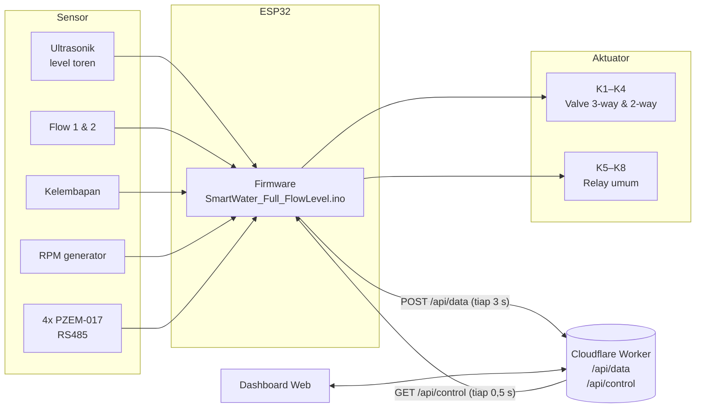

# Smart Water & Energy — Firmware ESP32


Firmware ESP32 untuk sistem **monitoring air & energi** berbasis IoT. Perangkat membaca
level toren, debit air, kelembapan, RPM generator, serta tegangan/arus/daya dari 4 unit
PZEM-017 (DC), lalu mengirim semuanya ke backend (Cloudflare Worker) dan menerima perintah
untuk mengendalikan **valve motor 3-way & 2-way** serta relay tambahan.

---

## Daftar Isi

- [Fitur](#fitur)
- [Arsitektur](#arsitektur)
- [Struktur Repositori](#struktur-repositori)
- [Kebutuhan Perangkat Keras](#kebutuhan-perangkat-keras)
- [Kebutuhan Perangkat Lunak](#kebutuhan-perangkat-lunak)
- [Mulai Cepat](#mulai-cepat)
- [Konfigurasi WiFi Pertama Kali](#konfigurasi-wifi-pertama-kali)
- [Logika Kontrol Valve](#logika-kontrol-valve)
- [Interval & Timing](#interval--timing)
- [Contoh Output Serial Monitor](#contoh-output-serial-monitor)
- [Keterbatasan yang Diketahui](#keterbatasan-yang-diketahui)
- [Keamanan](#keamanan)
- [Dokumentasi Lanjutan](#dokumentasi-lanjutan)
- [Lisensi](#lisensi)

---

## Fitur

| Kategori | Detail |
|---|---|
| **Level toren** | Sensor ultrasonik, median dari 5 sampel, kirim jarak mentah (cm) + persentase |
| **Debit air** | 2 sensor flow (FS300A), interrupt + debounce, satuan L/menit |
| **Kelembapan** | Sensor analog (ADC1, GPIO34), rata-rata 5 sampel, dikonversi ke % |
| **RPM generator** | Sensor pulsa (hall/IR), interrupt + debounce, filter anti-noise |
| **Energi** | 4× PZEM-017 pada satu bus RS485 (alamat 0x01–0x04); PZEM #3 dipakai sebagai tegangan baterai |
| **Baterai** | Estimasi persentase dari tegangan (tabel lookup) |
| **Valve** | 3-way & 2-way motorized valve, pulse **15 detik non-blocking** (`millis()`), interlock blue/brown |
| **Relay tambahan** | K5–K8 ON/OFF langsung mengikuti server |
| **Konektivitas** | WiFiManager (captive portal), auto-reconnect, HTTPS ke backend |
| **Waktu** | Sinkronisasi NTP (WIB, GMT+7) dengan retry otomatis |

## Arsitektur



## Struktur Repositori

```
.
├── SmartWater_Full_FlowLevel/
│   ├── SmartWater_Full_FlowLevel.ino   # Firmware utama
│   ├── secrets.example.h               # Template konfigurasi rahasia (di-commit)
│   └── secrets.h                       # Konfigurasi asli (TIDAK di-commit)
├── docs/
│   ├── WIRING.md                       # Pinout & skema koneksi
│   ├── API.md                          # Format JSON request/response backend
│   └── KALIBRASI.md                    # Panduan kalibrasi sensor
├── .github/workflows/compile.yml       # CI: uji kompilasi otomatis
├── .gitignore
├── .gitattributes
├── CHANGELOG.md
├── LICENSE
└── README.md
```

> Nama folder sketch **harus sama** dengan nama file `.ino` — ini aturan Arduino IDE.

## Kebutuhan Perangkat Keras

| Komponen | Jumlah | Keterangan |
|---|---|---|
| ESP32 DevKit (ESP32-WROOM-32) | 1 | Board target `esp32:esp32:esp32` |
| Sensor ultrasonik (HC-SR04 / JSN-SR04T) | 1 | Dipasang di atas toren, menghadap ke bawah |
| Sensor flow FS300A | 2 | Flow 1 & Flow 2 |
| Sensor kelembapan analog | 1 | Output ≤ 3,3 V |
| Sensor RPM (hall / IR) | 1 | 1 pulsa per putaran (default) |
| PZEM-017 v1 (DC) | 4 | Alamat Modbus 0x01–0x04 |
| Modul RS485 ↔ TTL | 1 | Tipe **kontrol arah otomatis** (firmware tidak mengatur pin DE/RE) |
| Modul relay 8 channel, *active LOW* | 1 | K1–K8 |
| Motorized valve 3-way | 1 | Kabel biru = buka, coklat = tutup |
| Motorized valve 2-way | 1 | Kabel biru = buka, coklat = tutup |

Detail pin dan catatan level tegangan ada di **[docs/WIRING.md](docs/WIRING.md)**.

## Kebutuhan Perangkat Lunak

Versi di bawah adalah versi yang dipakai saat firmware ini diuji kompilasi.

| Perangkat lunak | Versi | Sumber |
|---|---|---|
| Arduino IDE 2.x / `arduino-cli` | — | <https://www.arduino.cc/en/software> |
| ESP32 Arduino Core (Espressif) | 3.3.12 | Boards Manager, URL: `https://espressif.github.io/arduino-esp32/package_esp32_index.json` |
| WiFiManager (tzapu) | 2.0.17 | Library Manager |
| PZEM-017-v1 (maxzerker) | 1.0.0 | <https://github.com/maxzerker/PZEM-017-v1> (install via ZIP) |

`WiFi.h`, `HTTPClient.h`, dan `time.h` sudah termasuk dalam ESP32 core.

## Mulai Cepat

1. **Clone repositori**

   ```bash
   git clone https://github.com/<username>/<nama-repo>.git
   cd <nama-repo>
   ```

2. **Buat file konfigurasi rahasia**

   ```bash
   cp SmartWater_Full_FlowLevel/secrets.example.h SmartWater_Full_FlowLevel/secrets.h
   ```

   Lalu edit `secrets.h` dan isi URL backend serta password Access Point WiFiManager.

3. **Pasang board & library**
   - Arduino IDE → *File → Preferences → Additional boards manager URLs* → tambahkan URL ESP32 di atas.
   - *Tools → Board → Boards Manager* → pasang **esp32 by Espressif Systems**.
   - *Tools → Manage Libraries* → pasang **WiFiManager** by tzapu.
   - Unduh ZIP [PZEM-017-v1](https://github.com/maxzerker/PZEM-017-v1) → *Sketch → Include Library → Add .ZIP Library*.

4. **Upload**
   - Buka `SmartWater_Full_FlowLevel/SmartWater_Full_FlowLevel.ino`.
   - Board: **ESP32 Dev Module**, pilih port COM yang sesuai, klik **Upload**.
   - Buka Serial Monitor pada **115200 baud**.

   Atau lewat `arduino-cli`:

   ```bash
   arduino-cli compile --fqbn esp32:esp32:esp32 SmartWater_Full_FlowLevel
   arduino-cli upload  --fqbn esp32:esp32:esp32 -p COM3 SmartWater_Full_FlowLevel
   ```

   > Dengan partition scheme default, firmware ini memakai ± **88 % flash** (1,16 MB dari
   > 1,31 MB). Jika nanti fitur bertambah dan muncul error *"Sketch too big"*, pilih
   > *Tools → Partition Scheme → **Huge APP (3MB No OTA)***.

## Konfigurasi WiFi Pertama Kali

Firmware memakai [WiFiManager](https://github.com/tzapu/WiFiManager), jadi SSID/password WiFi
**tidak** ditulis di kode.

1. Saat pertama menyala (atau WiFi tersimpan tidak bisa terhubung dalam 15 detik), ESP32
   membuat Access Point **`SMART-WATER-SETUP`** dengan password dari `SECRET_WIFI_AP_PASSWORD`.
2. Hubungkan HP/laptop ke AP tersebut → halaman konfigurasi terbuka otomatis
   (atau buka `http://192.168.4.1`).
3. Pilih jaringan WiFi, masukkan password, simpan.
4. Jika portal tidak diisi dalam **300 detik**, ESP32 restart otomatis.

**Reset WiFi:** tahan tombol **BOOT (GPIO0)** selama **≥ 5 detik** tepat setelah ESP32
dinyalakan/di-reset. Pengaturan WiFi dihapus dan portal konfigurasi dibuka.

## Logika Kontrol Valve

| Relay | Pin | Fungsi |
|---|---|---|
| **K1** | GPIO23 | 3-way — kabel **biru** → **BUKA** |
| **K2** | GPIO22 | 3-way — kabel **coklat** → **TUTUP** |
| **K3** | GPIO21 | 2-way — kabel **biru** → **BUKA** |
| **K4** | GPIO19 | 2-way — kabel **coklat** → **TUTUP** |
| K5–K8 | GPIO18, 5, 4, 13 | Relay umum, ON/OFF mengikuti server |

Aturan yang dijalankan firmware:

- **Pulse 15 detik.** K1–K4 hanya aktif selama `VALVE_PULSE_TIME` (15 000 ms), lalu mati
  sendiri. Timer memakai `millis()`, tanpa `delay()` panjang.
- **Deteksi tepi (edge trigger).** Pulse hanya dimulai saat perintah server berubah
  `false → true`. Jika server terus mengirim `true`, pulse **tidak** diulang. Untuk perintah
  berikutnya, server harus mengirim `false` dulu, lalu `true` lagi.
- **Interlock.** Biru dan coklat tidak pernah aktif bersamaan:
  - Menyalakan biru (K1/K3) → semua coklat (K2, K4) dimatikan.
  - Menyalakan coklat (K2/K4) → semua biru (K1, K3) dimatikan.
  - **K1 + K3 boleh bersamaan** (biru + biru); K2 + K4 juga boleh (coklat + coklat).
  - Jika biru dan coklat diminta pada siklus yang sama, yang diproses terakhir
    (urutan K1 → K2 → K3 → K4) yang menang.
- **Flag posisi.** `valve3Position` / `valve2Position` (`OPEN` / `CLOSED`) menyimpan posisi
  valve terakhir, terpisah dari status relay. Flag diperbarui dari nilai yang dikirim server,
  lalu ditimpa oleh perintah baru (tepi naik K1–K4) pada siklus yang sama.
- **Saat boot.** Semua relay OFF, flag = `CLOSED`. Jika server **masih** menyimpan
  `relayX: true` untuk K1–K4, valve tersebut langsung mendapat pulse 15 detik setelah ESP32
  terhubung (karena dianggap tepi `false → true`).

## Interval & Timing

| Proses | Interval | Konstanta |
|---|---|---|
| Baca kelembapan + ultrasonik | 500 ms | `SENSOR_INTERVAL` |
| Hitung flow & RPM | ≥ 1 000 ms (jendela sampel) | `readPulseSensors()` |
| Ambil perintah (`GET /api/control`) | 500 ms | `CONTROL_INTERVAL` |
| Baca PZEM + kirim data (`POST /api/data`) + cetak status | 3 000 ms | `DATA_INTERVAL` |
| Cek koneksi WiFi | 5 000 ms | `WIFI_CHECK_INTERVAL` |
| Retry NTP (jika gagal) | 60 000 ms | `NTP_RETRY_INTERVAL` |
| Durasi pulse valve | 15 000 ms | `VALVE_PULSE_TIME` |

## Contoh Output Serial Monitor

```
======================================
 SMART WATER & ENERGY
 FINAL SENSOR + VALVE SYSTEM
======================================
WiFi       : CONNECTED
SSID       : NamaWiFi
RSSI       : -58 dBm
IP         : 192.168.1.23

Humidity   : 42.5 % RAW=3164
Toren RAW  : 48.3 cm (sensor -> permukaan air)
Flow 1     : 3.27 L/min
Flow 2     : 0.00 L/min
RPM        : 412 RPM

3-WAY FLAG : OPEN
2-WAY FLAG : CLOSED

RELAY:
K1 = ON
K2 = OFF
...
======================================
```

*(Nilai di atas hanya ilustrasi format.)*

## Keterbatasan yang Diketahui

- **Faktor flow & geometri toren masih provisional.** `FLOW_FACTOR = 5.5` (FS300A) dan
  dimensi toren (125 cm kosong, 20 cm penuh) perlu diverifikasi — lihat
  [docs/KALIBRASI.md](docs/KALIBRASI.md).
- **Parser JSON berbasis pencarian string.** Respons `/api/control` harus berupa JSON
  *compact* (tanpa spasi setelah `:`), misalnya `"relay1":true`. Lihat [docs/API.md](docs/API.md).
- **Request HTTP bersifat blocking.** Selama request berjalan (timeout hingga 5–6 detik saat
  jaringan buruk), timer relay tidak dicek, sehingga pulse valve bisa sedikit lebih lama
  dari 15 detik.
- **Mode `AUTO`/`MANUAL` hanya disimpan & dilaporkan.** Firmware tidak menjalankan logika
  otomatis sendiri; relay selalu mengikuti perintah dari server.
- **Flag posisi valve tidak disimpan ke flash.** Setelah restart, flag kembali `CLOSED`
  kecuali server mengirim nilai `valve3Position` / `valve2Position`.

## Keamanan

- URL backend dan password AP disimpan di `secrets.h`, yang **di-ignore Git**. Hanya
  `secrets.example.h` (berisi placeholder) yang di-commit.
- Endpoint `/api/control` dan `/api/data` saat ini **tanpa autentikasi**. Siapa pun yang
  mengetahui URL-nya dapat membaca data atau mengirim perintah valve. Untuk produksi,
  pertimbangkan menambahkan API key / token di header dan memvalidasinya di Worker.
- Jika URL asli pernah ter-commit ke repositori publik, anggap URL tersebut sudah bocor:
  ganti nama Worker / tambahkan autentikasi.

## Dokumentasi Lanjutan

- [docs/WIRING.md](docs/WIRING.md) — pinout lengkap & catatan perangkat keras
- [docs/API.md](docs/API.md) — kontrak JSON antara ESP32 dan backend
- [docs/KALIBRASI.md](docs/KALIBRASI.md) — cara kalibrasi sensor & baterai
- [CHANGELOG.md](CHANGELOG.md) — riwayat perubahan

## Lisensi

Dirilis di bawah lisensi [MIT](LICENSE).
